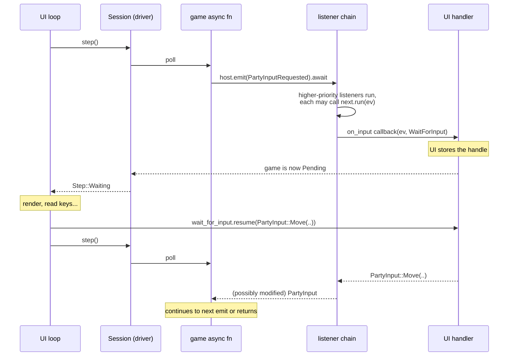

# The plan

> 🚧 This chapter is a living design document for `v0.4.0`. Decisions marked **Decided** are settled; anything under
> [Open questions](./plan/open_questions.md) is not.

`v0.4` replaces the `Play` trait, the game-state `Host`, and the `genawaiter` dependency with four pieces:

1. **Games are plain `async fn`s** written entirely by the user of the library. `posturn` does not define what a game
   is; it only provides the machinery to run one. (See [Games are just `async fn`s](./plan/games.md).)
2. **The `Host` is a registry of modules.** Each module is a separate piece of state, keyed by its type, that the UI
   can inspect between turns. (See [The `Host` and modules](./plan/host.md).)
3. **Events are types.** The game `emit`s an event and `await`s its typed output. Listeners registered on the `Host`
   form a chain that can handle, override, or post-process each event. (See [Events and listeners](./plan/events.md).)
4. **The UI is the bottom of the chain.** The UI registers plain callbacks that receive a `Suspend` or
   `WaitForInput<R>` handle, which pauses the game until the UI is ready to continue. (See
   [Handing control to the UI](./plan/ui_handlers.md).)

The rest of this chapter covers [driving the game](./plan/driving.md), the
[coroutine machinery underneath](./plan/coroutines.md), a [worked example](./plan/example.md),
[open questions](./plan/open_questions.md), [future work](./plan/future_work.md), and the
[implementation steps](./plan/implementation.md).

## How a turn flows

## Hard constraints

- **Single-threaded and cooperative.** No threads, no executor crate, no `Send`/`Sync` anywhere in the public API.
  `Host`, handles, and the driver are deliberately `!Send` and `!Sync` (they are built on `Rc`).
- **No dependencies.** `genawaiter` is removed and nothing replaces it.
- **The caller drives the game by hand.** `posturn` never polls on its own.
- **No `unsafe`** outside the standard no-op `Waker` construction.
