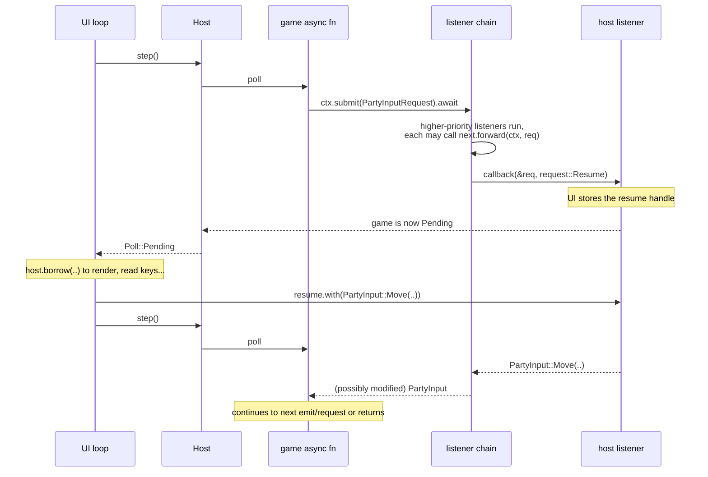

<!--
SPDX-FileCopyrightText: 2026 Andrew T. Christensen <andrew@andrewtc.com>

SPDX-License-Identifier: CC-BY-SA-4.0
-->

# The plan

> 🚧 This chapter is a living design document for `v0.4.0`. Decisions marked **Decided** are settled; anything under
> [Open questions](./plan/open_questions.md) is not.

`v0.4` replaces the `Play` trait, the old game-state `Host`, and the `genawaiter` dependency with these pieces:

1. **A `Setup` turns into the game.** Each game has a setup struct holding its inputs. Implementing the `Setup` trait
   means registering the game's modules and returning the game itself as an `async` function, written entirely by the
   user of the library. `posturn` does not define what a game is; it only provides the machinery to run one. (See
   [Setting up a game](./plan/games.md).)
2. **One registry, several views of it.** All shared state lives in a `Registry`, including the **modules**: separate
   pieces of state, keyed by type, registered during setup. The UI creates a `Host<Outcome>` from a `Setup`; the host
   runs the game and lets the UI read modules. The game owns the only `CtxMut`, through which it reads and writes
   modules, emits events, and submits requests. A `Ctx` is a read-only view that any of them can hand out. They all look
   up modules through the same `module::Borrow` / `module::BorrowMut` traits, and the borrow checker guarantees that no
   module is borrowed while control passes between the UI and the game. (See [`Host`, contexts, and
   modules](./plan/host.md).)
3. **Events and requests are types.** The game `emit`s events (broadcasts, which implement `Event`) and `submit`s
   requests (which implement `Request` and resolve to a typed `Response`). Listeners, registered at any time with a
   priority, form a chain for each message type that can handle, override, or post-process each message. Registering
   one returns a handle, and dropping the handle unregisters the listener. (See [Events, requests, and
   listeners](./plan/events.md).)
4. **The UI joins the chain.** The UI registers plain (non-`async`) listeners on the `Host` (also `on_event` and
   `on_request`), which are sorted into the same chains by priority. Each receives an `event::Resume` or
   `request::Resume<T>`, which keeps the game paused until the UI is ready to continue. (See [Handing control to the
   UI](./plan/ui_handlers.md).)

For a map of every type and how they relate, see [How the pieces fit](./plan/types.md).

The rest of this chapter covers [driving the game](./plan/driving.md), the
[coroutine machinery underneath](./plan/coroutines.md), a [worked example](./plan/example.md),
[open questions](./plan/open_questions.md), [future work](./plan/future_work.md), and the
[implementation steps](./plan/implementation.md).

## How a turn flows

## Hard constraints

- **Single-threaded and cooperative.** No threads, no executor crate, no `Send`/`Sync` anywhere in the public API.
  `Host`, `CtxMut`, and all handles are deliberately `!Send` and `!Sync` (they are built on `Rc`).
- **No dependencies.** `genawaiter` is removed and nothing replaces it.
- **The caller drives the game by hand.** `posturn` never polls on its own.
- **Borrowing mistakes are compile errors** where possible: holding a module borrow while the game suspends, or
  while the UI steps the game, does not compile.
- **No `unsafe`.** The module map is frozen when setup ends, so borrows come straight out of a fixed map.
- **MSRV of Rust 1.86. Decided.** `AsyncFn` (async closures) and `Waker::noop()` need 1.85; trait upcasting
  (`&dyn Module` to `&dyn Any`, as in the `module` patch) needs 1.86.
