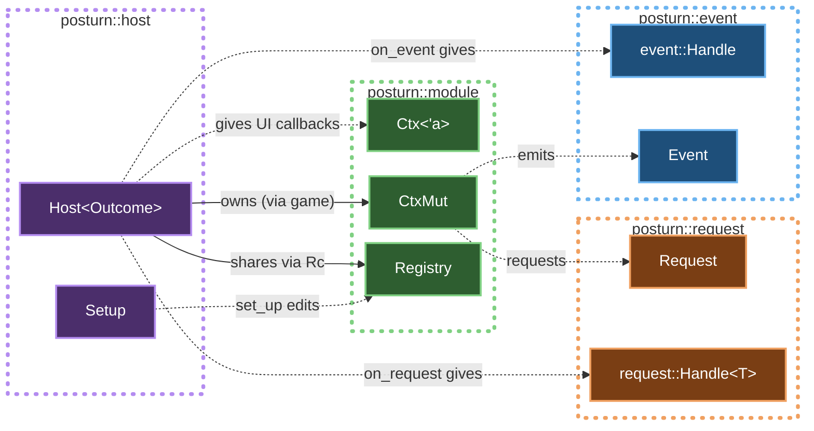
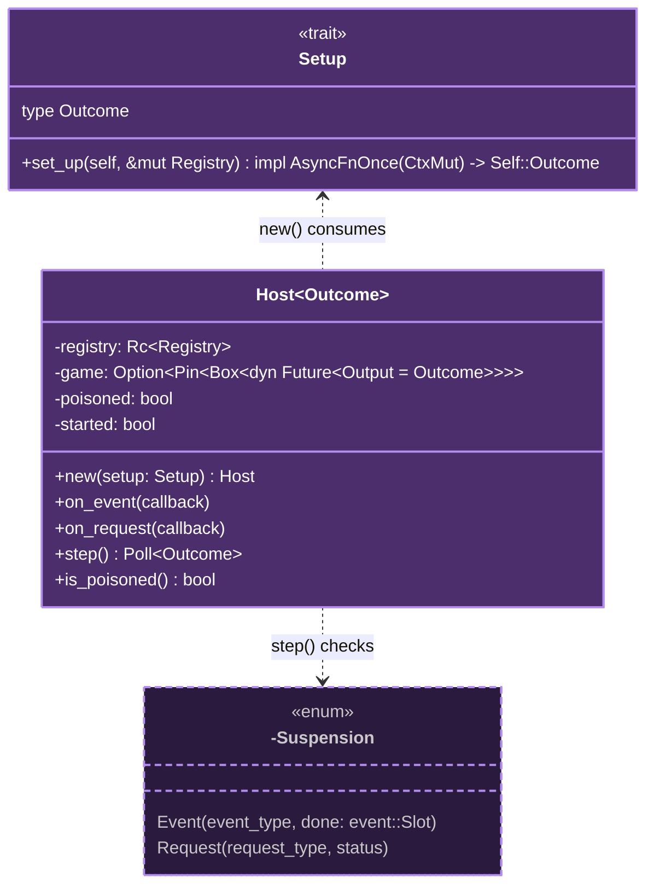
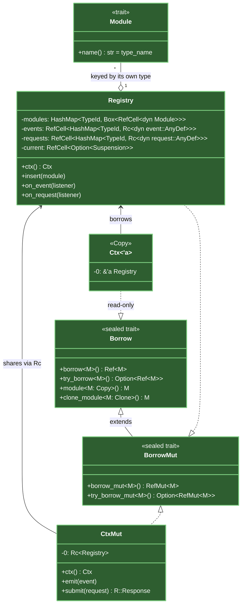
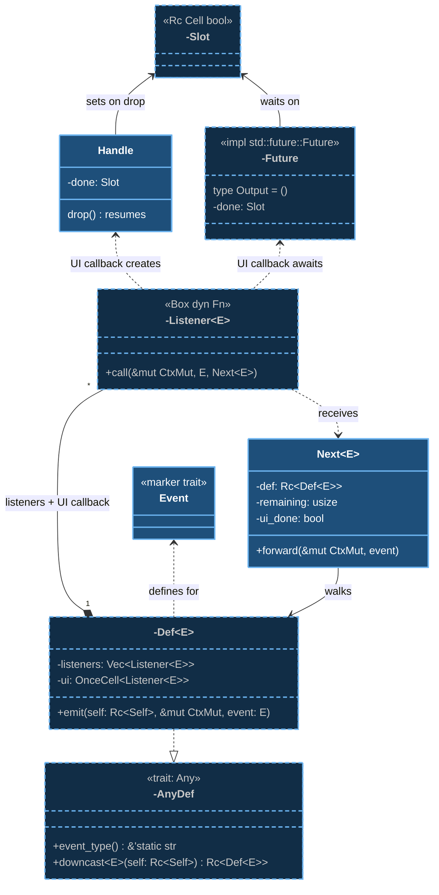
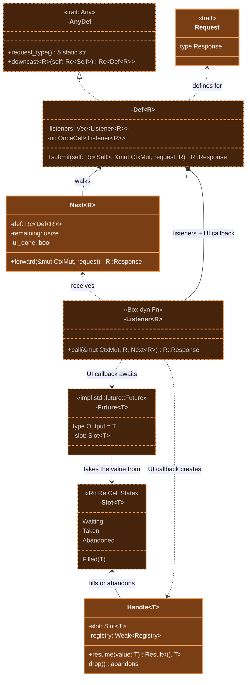

# How the pieces fit

This page is a map of every type in the plan and how they relate. Each type is described in more detail on its own
page; the diagrams are the big picture.

**Decided:** the types are split across four Rust modules, each with its own color: `posturn::host` (purple),
`posturn::module` (green), `posturn::event` (blue), and `posturn::request` (orange).

- **API at a glance** is a simplified overview of the high-level API structure. It shows only the main **public**
  types that connect the modules, by name. Dotted arrows are dependencies (one type uses, creates, or hands out the
  other); solid arrows mean one type holds or refers to the other.
- **Each module's section** then has a full class diagram of all of that module's types, public and private, and
  the relationships between them.

**Names** don't repeat their module (per Clippy's `module_name_repetitions`), so types outside their own module's
diagram are written module-qualified: `event::Listener`, `request::Slot`, `module::Borrow`. Within a module's own
diagram, the bare name is used.

**Visibility** follows UML notation: a `-` prefix marks something private. Members already use it; types that are
private to the crate (never named by users of `posturn`) are also drawn with a `-` before their name, a darker fill,
and a dashed outline.

## API at a glance

## `posturn::host`

- **`Host<Outcome>`** (UI side). Created from a `Setup`. Holds one `Rc<Registry>` and the game future (pinned and boxed,
  `None` once finished). The UI registers its callbacks on it, reads modules through it between turns, and calls
  `step()` to advance the game. Implements `module::Borrow` only: the UI can't write modules. Module borrows take
  `&self` and `step()` takes `&mut self`, so the UI can't hold a borrow across a step. A panic during `step()`
  poisons it (`is_poisoned()`), and every later `step()` panics. See [`Host`, contexts, and modules](./host.md) and
  [Driving the game](./driving.md).
- **`Suspension`** (enum). What the game is currently parked on: an event (its `event::Slot`) or a request (the
  type-erased status of its `request::Slot`), plus the message's type name for error messages. Stored in the
  `Registry`; `Host::step()` checks it to decide whether to do nothing, panic, or poll. See
  [Under the hood](./coroutines.md#current-suspension).
- **`Setup`** (trait). Implemented by a struct holding everything needed to start one game. `set_up` registers the
  game's modules and listeners and returns the game as an async function. `Host::new` takes a `Setup` by value. See
  [Setting up a game](./games.md).

## `posturn::module`

See [Looking up modules](./host.md#looking-up-modules).

- **`Registry`.** Holds all shared state: modules, event and request definitions, and the current suspension, in
  `HashMap`s keyed by `TypeId`; see [Inside the `Registry`](./host.md#inside-the-registry). Users only see it as
  `&mut Registry` during `set_up`, where they `insert` modules and register listeners with `on_event` / `on_request`.
  `Host::new` then moves it into an `Rc`, which freezes it: no `&mut` access ever again. Implements both module traits.
- **`CtxMut`** (game side). A non-`Clone` newtype around the other `Rc<Registry>`; only `Host::new` creates one. It is
  handed to the game's async function by value. Implements both module traits. Module borrows take `&self`;
  everything that can suspend (`emit`, `submit`, and `forward` on an `event::Next` / `request::Next`) takes `&mut self`,
  so the game can't hold a borrow across a suspension.
- **`Module`** (trait, extends `Any`). A piece of game state published so that the UI can inspect it, such as
  `OverworldModule` or `BattleModule`. One instance per type, stored as a `RefCell<dyn Module>` keyed by its own type,
  and downcast after lookup. Its only method, `name()`, is for diagnostics and defaults to the type name, so
  `impl Module for MyModule {}` is usually enough.
- **`module::Borrow`** (sealed trait). Read access: `borrow`, `try_borrow`, `module`, `clone_module`. Implemented by
  `Registry`, `CtxMut`, `Ctx`, and `Host`, so all of them look up modules the same way.
- **`module::BorrowMut`** (sealed trait, extends `module::Borrow`). Write access: `borrow_mut`, `try_borrow_mut`.
  Implemented by `Registry` and `CtxMut` only.
- **`Ctx<'a>`.** A read-only, `Copy` view of the modules, obtained with `.ctx()` from a `Registry` or `CtxMut`, and
  handed to every UI callback by the `Host`. Implements `module::Borrow` only. Borrows its source, so it inherits the
  source's restrictions under the [borrowing rule](./host.md#the-borrowing-rule).

## `posturn::event`

Events and requests are processed by separate types throughout. See
[Events, requests, and listeners](./events.md) and [Under the hood](./coroutines.md).

- **`Event`** (marker trait). Declares a type as an event. Events are broadcast with `ctx.emit(ev).await`, which
  returns `()`.
- **`event::Def<E>`** (private). The definition of event `E`: its game listeners (the last registered runs first) and
  its UI callback (a `OnceCell`, so at most one), plus `emit`, which runs an `E` through them. Stored in the `Registry`
  keyed by `TypeId::of::<E>()`. See [Definitions and dispatch](./events.md#definitions-and-dispatch).
- **`event::AnyDef`** (private marker trait, `Any` plus `event_type()`). What the `Registry` stores every `Def<E>` as.
  `ctx.emit` calls `downcast::<E>()` (an inherent method on `dyn AnyDef`) and then `Def<E>::emit` with the event,
  fully typed.
- **`event::Listener<E>`** (`Box<dyn Fn(&mut CtxMut, E, event::Next<E>) -> LocalBoxFuture<()>>`). What an async
  function or async closure registered with `Registry::on_event` is wrapped into. `Host::on_event` callbacks are
  wrapped into one too.
- **`event::Next<E>`.** The rest of the chain: an `Rc` of the definition, how many game listeners remain, and whether
  the UI callback has run. `next.forward(ctx, ev)` calls the next one; at the end of the chain it simply returns.
- **`event::Handle`.** What a `Host::on_event` callback receives. It has no methods: dropping it lets the game continue.
- **`event::Future`** (`Future<Output = ()>`). What the UI callback's listener awaits; ready once the `event::Handle` is
  dropped.
- **`event::Slot`** (`Rc<Cell<bool>>`). Shared by an `event::Handle` and its `event::Future`; set to `true` on drop.

## `posturn::request`

- **`Request`** (trait). Implemented by each request type. Its associated `Response` is what
  `ctx.submit(req).await` resolves to.
- **`request::Def<R>`** (private). The definition of request `R`: its game listeners and UI callback, like
  `event::Def`. Stored in the `Registry` keyed by `TypeId::of::<R>()`.
- **`request::AnyDef`** (private marker trait, `Any` plus `request_type()`). What the `Registry` stores every `Def<R>`
  as. `ctx.submit` calls `downcast::<R>()` and then `Def<R>::submit`, which returns an `R::Response`.
- **`request::Listener<R>`** (`Box<dyn Fn(&mut CtxMut, R, request::Next<R>) -> LocalBoxFuture<R::Response>>`). What a
  listener registered with `Registry::on_request` is wrapped into. `Host::on_request` callbacks are wrapped into one
  too.
- **`request::Next<R>`.** Like `event::Next`, but `next.forward(ctx, req)` returns `R::Response`, and reaching the end
  of the chain panics.
- **`request::Handle<T>`** (`T = R::Response`). What a `Host::on_request` callback receives. It must be consumed with
  `resume(value)`; dropping it without resuming abandons the request, and the next `step()` panics. If the `Host` is
  already gone, `resume` returns `Err(value)` instead.
- **`request::Future<T>`** (`Future<Output = T>`). What the UI callback's listener awaits; takes the value out of the
  slot once it is filled.
- **`request::Slot<T>`** (`Rc<RefCell<request::State<T>>>`). Shared by a `request::Handle` and its `request::Future`:
  `Waiting`, `Filled(T)`, `Taken`, or `Abandoned`.
