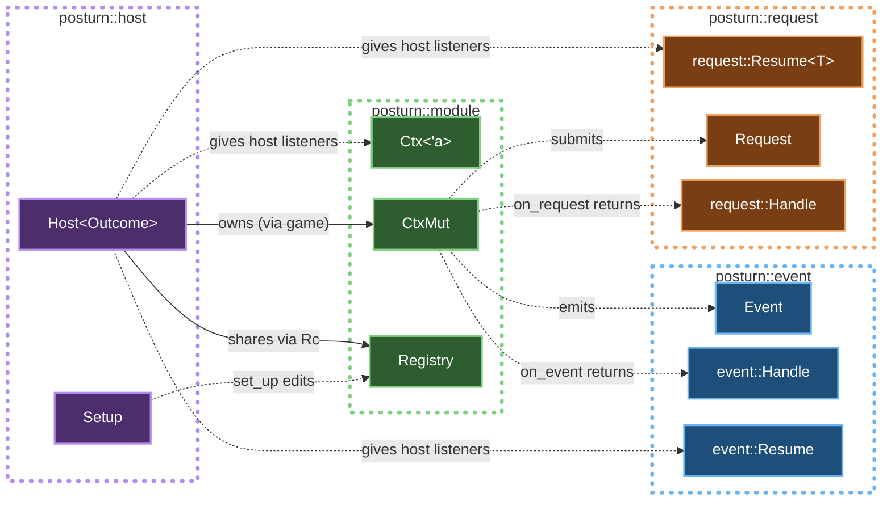
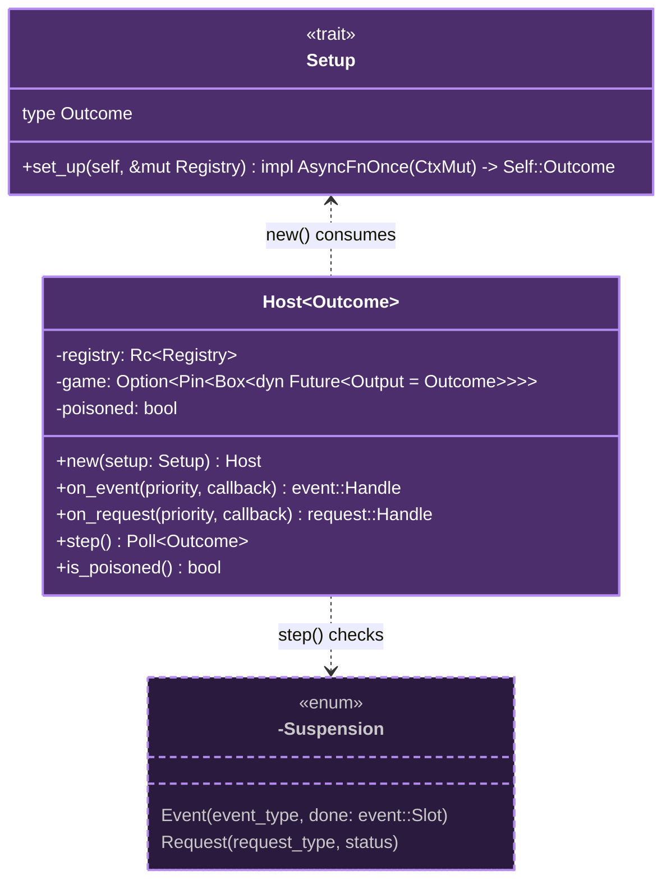
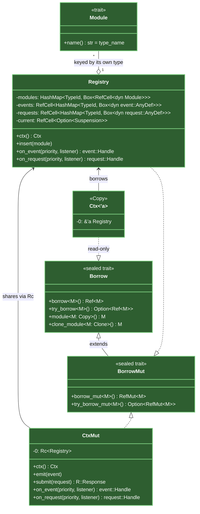

<!--
SPDX-FileCopyrightText: 2026 Andrew T. Christensen <andrew@andrewtc.com>

SPDX-License-Identifier: CC-BY-SA-4.0
-->

# How the pieces fit

This page is a map of every type in the plan and how they relate. Each type is described in more detail on its own
page; the diagrams are the big picture.

**Decided:** the types are split across four Rust modules, each with its own color: `posturn::host` (purple),
`posturn::module` (green), `posturn::event` (blue), and `posturn::request` (orange).

- **API at a glance** is a simplified overview of the high-level API structure. It shows only the main **public**
  types that connect the modules, by name. Dotted arrows are dependencies (one type uses, creates, or hands out the
  other); solid arrows mean one type holds or refers to the other.
- **Each module's section** then has a full class diagram of all of that module's types, public and private, and
  the relationships between them.

**Names** don't repeat their module (per Clippy's `module_name_repetitions`), so types outside their own module's
diagram are written module-qualified: `event::Handle`, `request::Resume`, `module::Borrow`. Within a module's own
diagram, the bare name is used.

**Visibility** follows UML notation: a `-` prefix marks something private. Members already use it; types that are
private to the crate (never named by users of `posturn`) are also drawn with a `-` before their name, a darker fill,
and a dashed outline.

## API at a glance

`Host` and `Registry` return handles from `on_event` / `on_request` too, just like `CtxMut`; the overview only draws
`CtxMut`'s arrows.

## `posturn::host`

- **`Host<Outcome>`** (UI side). Created from a `Setup`. Holds one `Rc<Registry>` and the game future (pinned and boxed,
  `None` once finished). The UI registers its listeners on it at any time (each returning a handle), reads modules
  through it between turns, and calls `step()` to advance the game. Implements `module::Borrow` only: the UI can't
  write modules. Module borrows take `&self` and `step()` takes `&mut self`, so the UI can't hold a borrow across a
  step. A panic during `step()` poisons it (`is_poisoned()`), and every later `step()` panics. See
  [`Host`, contexts, and modules](./host.md), [Handing control to the UI](./ui_handlers.md), and
  [Driving the game](./driving.md).
- **`Suspension`** (enum). What the game is currently parked on: an event (its `event::Slot`) or a request (the
  type-erased status of its `request::Slot`), plus the message's type name for error messages. Stored in the
  `Registry`; `Host::step()` checks it to decide whether to do nothing, panic, or poll. See
  [Under the hood](./coroutines.md#current-suspension).
- **`Setup`** (trait). Implemented by a struct holding everything needed to start one game. `set_up` inserts the
  game's modules, registers its initial listeners, and returns the game as an async function. `Host::new` takes a
  `Setup` by value. See [Setting up a game](./games.md).

## `posturn::module`

See [Looking up modules](./host.md#looking-up-modules).

- **`Registry`.** Holds all shared state: modules, event and request definitions, and the current suspension, in
  `HashMap`s keyed by `TypeId`; see [Inside the `Registry`](./host.md#inside-the-registry). Users only see it as
  `&mut Registry` during `set_up`, where they `insert` modules and register the game's initial listeners with
  `on_event` / `on_request`. `Host::new` then moves it into an `Rc`, which freezes its modules: no `&mut` access ever
  again. Implements both module traits.
- **`CtxMut`** (game side). A non-`Clone` newtype around the other `Rc<Registry>`; only `Host::new` creates one. It is
  handed to the game's async function by value. Implements both module traits, and registers game listeners at any
  time with `on_event` / `on_request`. Module borrows and registration take `&self`; everything that can suspend
  (`emit`, `submit`, and `forward` on an `event::Next` / `request::Next`) takes `&mut self`, so the game can't hold a
  borrow across a suspension.
- **`Module`** (trait, extends `Any`). A piece of game state published so that the UI can inspect it, such as
  `OverworldModule` or `BattleModule`. One instance per type, stored as a `RefCell<dyn Module>` keyed by its own type,
  and downcast after lookup. Its only method, `name()`, is for diagnostics and defaults to the type name, so
  `impl Module for MyModule {}` is usually enough. A module is also where the game keeps the handles of listeners that
  should last the whole game.
- **`module::Borrow`** (sealed trait). Read access: `borrow`, `try_borrow`, `module`, `clone_module`. Implemented by
  `Registry`, `CtxMut`, `Ctx`, and `Host`, so all of them look up modules the same way.
- **`module::BorrowMut`** (sealed trait, extends `module::Borrow`). Write access: `borrow_mut`, `try_borrow_mut`.
  Implemented by `Registry` and `CtxMut` only.
- **`Ctx<'a>`.** A read-only, `Copy` view of the modules, obtained with `.ctx()` from a `Registry` or `CtxMut`, and
  handed to every host listener by the `Host`. Implements `module::Borrow` only. Borrows its source, so it inherits the
  source's restrictions under the [borrowing rule](./host.md#the-borrowing-rule).

## `posturn::event`

```mermaid
%%{init: {"class": {"nodeSpacing": 25, "rankSpacing": 20}}}%%
classDiagram
    direction TB

    %% Generics that nest, or contain `()`, are written with HTML entities (`#lt;`, `#gt;`, `#40;`, `#41;`): Mermaid
    %% misreads nested `~T~` generics as Markdown strikethrough, and treats any member containing `()` as a method.
    %% Layout: the order of declarations and the direction of each arrow (e.g. `A <.. B` instead of `B ..> A`, which
    %% means the same thing) were tuned by measuring rendered variants for size and edge crossings. Reordering lines
    %% or flipping arrows here can change the layout noticeably.

    class AnyDef["-AnyDef"] {
        <<trait: Any>>
        +event_type() &'static str
        +downcast_ref~E~() &Def~E~
        +downcast_mut~E~() &mut Def~E~
    }

    class Slot["-Slot"] {
        <<Rc Cell bool>>
    }

    class Listener["-Listener#lt;E#gt;"] {
        -priority: E::Priority
        -callback: RefCell#lt;Option#lt;Callback#lt;E#gt;#gt;#gt;
    }

    class Handle {
        <<must_use>>
        -listener: Option#lt;Weak#lt;dyn AnyListener#gt;#gt;
        +forever()
        drop() unregisters
    }

    class Event {
        <<trait>>
        type Priority: Ord
    }

    class AnyListener["-AnyListener"] {
        <<trait>>
        +clear()
    }

    class Resume {
        -done: Slot
        drop() continues
    }

    class Future["-Future"] {
        <<impl std::future::Future>>
        type Output = #40;#41;
        -done: Slot
    }

    class Next~E~ {
        -chain: Vec#lt;Rc#lt;Listener#lt;E#gt;#gt;#gt;
        -at: usize
        +forward(&mut CtxMut, event)
    }

    class Callback["-Callback#lt;E#gt;"] {
        <<enum>>
        Game(Rc#lt;dyn Fn#gt;)
        Host(Rc#lt;RefCell#lt;dyn FnMut#gt;#gt;)
    }

    class Def["-Def#lt;E#gt;"] {
        -chain: Vec#lt;Rc#lt;Listener#lt;E#gt;#gt;#gt;
        -next() Next~E~
        -insert(priority, callback) Handle
    }

    Event <.. Def : defines for
    Listener --> Callback : holds until cleared
    Slot <-- Future : waits on
    Listener <-- Next : walks a copy of
    Future <.. Next : awaits for Host
    Next <.. Callback : Game receives
    Next ..> Resume : creates for Host
    Handle --> AnyListener : clears on drop
    Resume --> Slot : sets on drop
    Def "1" *-- "*" Listener : sorted chain
    AnyListener <|.. Listener
    Def ..> Handle : insert returns
    AnyDef <|.. Def

    style Event fill:#1e4f7a,stroke:#6cb4f0,stroke-width:2px,color:#ffffff
    style Handle fill:#1e4f7a,stroke:#6cb4f0,stroke-width:2px,color:#ffffff
    style Next fill:#1e4f7a,stroke:#6cb4f0,stroke-width:2px,color:#ffffff
    style Resume fill:#1e4f7a,stroke:#6cb4f0,stroke-width:2px,color:#ffffff
    style Def fill:#112d46,stroke:#6cb4f0,stroke-width:2px,stroke-dasharray:6 4,color:#c8c8c8
    style AnyDef fill:#112d46,stroke:#6cb4f0,stroke-width:2px,stroke-dasharray:6 4,color:#c8c8c8
    style Listener fill:#112d46,stroke:#6cb4f0,stroke-width:2px,stroke-dasharray:6 4,color:#c8c8c8
    style AnyListener fill:#112d46,stroke:#6cb4f0,stroke-width:2px,stroke-dasharray:6 4,color:#c8c8c8
    style Callback fill:#112d46,stroke:#6cb4f0,stroke-width:2px,stroke-dasharray:6 4,color:#c8c8c8
    style Slot fill:#112d46,stroke:#6cb4f0,stroke-width:2px,stroke-dasharray:6 4,color:#c8c8c8
    style Future fill:#112d46,stroke:#6cb4f0,stroke-width:2px,stroke-dasharray:6 4,color:#c8c8c8
```

Events and requests are processed by separate types throughout. See
[Events, requests, and listeners](./events.md) and [Under the hood](./coroutines.md).

- **`Event`** (trait). Declares a type as an event, and names the `Priority` type its listeners are ordered by. Events
  are broadcast with `ctx.emit(ev).await`, which returns `()`.
- **`event::Def<E>`** (private). The definition of event `E`: its chain of listeners, sorted by priority (greatest
  first, newest first among equals). `insert` adds a listener at its sorted place, pruning cleared listeners, and
  returns its handle; `next` copies the chain into a fresh `Next` for each `emit`. Stored in the `Registry` keyed by
  `TypeId::of::<E>()`. See [Definitions and dispatch](./events.md#definitions-and-dispatch).
- **`event::AnyDef`** (private marker trait, `Any` plus `event_type()`). What the `Registry` stores every `Def<E>` as.
  `ctx.emit` calls `downcast_ref::<E>()`, and registration `downcast_mut::<E>()` (inherent methods on `dyn AnyDef`),
  after which everything is fully typed.
- **`event::Listener<E>`** (private). One registered listener: its priority, and its callback in a
  `RefCell<Option<..>>`, which its handle clears.
- **`event::Callback<E>`** (private enum). What a listener runs: `Game`, a game listener's `AsyncFn` (registered
  through `Registry` or `CtxMut`, and boxed so that each call boxes its future), or `Host`, a host listener's `FnMut`
  (registered through `Host`). Cloning one only clones an `Rc`.
- **`event::AnyListener`** (private trait). Lets a non-generic `event::Handle` clear a `Listener<E>` without knowing
  `E`.
- **`event::Handle`.** Returned by every `on_event` (on `Registry`, `CtxMut`, and `Host`). Holds a `Weak` to its
  listener; dropping it unregisters the listener and drops its callback, while `forever()` gives it up and leaves the
  listener registered for as long as the `Registry` exists. `#[must_use]`, and not generic, so one
  `Vec<event::Handle>` can hold handles for many event types. See [Handles](./events.md#handles).
- **`event::Next<E>`.** The rest of the chain: a copy of the chain, taken when the event was emitted, and the index of
  the next listener. `next.forward(ctx, ev)` loops over the copy: it skips cleared listeners, hands over to the next
  game listener, and waits at each host listener until its `event::Resume` drops. At the end of the chain it simply
  returns.
- **`event::Resume`.** What a host listener receives. It has no methods: dropping it lets the event continue down the
  chain.
- **`event::Future`** (`Future<Output = ()>`). What `forward` awaits at a host listener; ready once the
  `event::Resume` is dropped.
- **`event::Slot`** (`Rc<Cell<bool>>`). Shared by an `event::Resume` and its `event::Future`; set to `true` on drop.

## `posturn::request`

```mermaid
%%{init: {"class": {"nodeSpacing": 25, "rankSpacing": 20}}}%%
classDiagram
    direction TB

    %% Generics that nest, or contain `()`, are written with HTML entities (`#lt;`, `#gt;`, `#40;`, `#41;`): Mermaid
    %% misreads nested `~T~` generics as Markdown strikethrough, and treats any member containing `()` as a method.
    %% Layout: the order of declarations and the direction of each arrow (e.g. `A <.. B` instead of `B ..> A`, which
    %% means the same thing) were tuned by measuring rendered variants for size and edge crossings. Reordering lines
    %% or flipping arrows here can change the layout noticeably.

    class AnyDef["-AnyDef"] {
        <<trait: Any>>
        +request_type() &'static str
        +downcast_ref~R~() &Def~R~
        +downcast_mut~R~() &mut Def~R~
    }

    class Slot["-Slot#lt;T#gt;"] {
        <<Rc RefCell State>>
        Waiting
        Filled(T)
        Passed
        Taken
        Abandoned
    }

    class Listener["-Listener#lt;R#gt;"] {
        -priority: R::Priority
        -callback: RefCell#lt;Option#lt;Callback#lt;R#gt;#gt;#gt;
    }

    class Handle {
        <<must_use>>
        -listener: Option#lt;Weak#lt;dyn AnyListener#gt;#gt;
        +forever()
        drop() unregisters
    }

    class Request {
        <<trait>>
        type Response
        type Priority: Ord
    }

    class AnyListener["-AnyListener"] {
        <<trait>>
        +clear()
    }

    class Resume~T~ {
        -slot: Slot~T~
        -registry: Weak~Registry~
        +with(value: T) Result#lt;#40;#41;, T#gt;
        +resume()
        drop() abandons
    }

    class Future["-Future#lt;T#gt;"] {
        <<impl std::future::Future>>
        type Output = Option~T~
        -slot: Slot~T~
    }

    class Next~R~ {
        -chain: Vec#lt;Rc#lt;Listener#lt;R#gt;#gt;#gt;
        -at: usize
        +forward(&mut CtxMut, request) R::Response
    }

    class Callback["-Callback#lt;R#gt;"] {
        <<enum>>
        Game(Rc#lt;dyn Fn#gt;)
        Host(Rc#lt;RefCell#lt;dyn FnMut#gt;#gt;)
    }

    class Def["-Def#lt;R#gt;"] {
        -chain: Vec#lt;Rc#lt;Listener#lt;R#gt;#gt;#gt;
        -next() Next~R~
        -insert(priority, callback) Handle
    }

    Request <.. Def : defines for
    Listener --> Callback : holds until cleared
    Slot <-- Future : takes the outcome from
    Listener <-- Next : walks a copy of
    Future <.. Next : awaits for Host
    Next <.. Callback : Game receives
    Next ..> Resume : creates for Host
    Handle --> AnyListener : clears on drop
    Resume --> Slot : fills, passes, or abandons
    Def "1" *-- "*" Listener : sorted chain
    AnyListener <|.. Listener
    Def ..> Handle : insert returns
    AnyDef <|.. Def

    style Request fill:#7a3e14,stroke:#f0a060,stroke-width:2px,color:#ffffff
    style Handle fill:#7a3e14,stroke:#f0a060,stroke-width:2px,color:#ffffff
    style Next fill:#7a3e14,stroke:#f0a060,stroke-width:2px,color:#ffffff
    style Resume fill:#7a3e14,stroke:#f0a060,stroke-width:2px,color:#ffffff
    style Def fill:#46230b,stroke:#f0a060,stroke-width:2px,stroke-dasharray:6 4,color:#c8c8c8
    style AnyDef fill:#46230b,stroke:#f0a060,stroke-width:2px,stroke-dasharray:6 4,color:#c8c8c8
    style Listener fill:#46230b,stroke:#f0a060,stroke-width:2px,stroke-dasharray:6 4,color:#c8c8c8
    style AnyListener fill:#46230b,stroke:#f0a060,stroke-width:2px,stroke-dasharray:6 4,color:#c8c8c8
    style Callback fill:#46230b,stroke:#f0a060,stroke-width:2px,stroke-dasharray:6 4,color:#c8c8c8
    style Slot fill:#46230b,stroke:#f0a060,stroke-width:2px,stroke-dasharray:6 4,color:#c8c8c8
    style Future fill:#46230b,stroke:#f0a060,stroke-width:2px,stroke-dasharray:6 4,color:#c8c8c8
```

- **`Request`** (trait). Implemented by each request type. Its associated `Response` is what
  `ctx.submit(req).await` resolves to, and its `Priority` orders its listeners.
- **`request::Def<R>`**, **`request::AnyDef`**, **`request::Listener<R>`**, **`request::AnyListener`** (private). Like
  their `event` counterparts.
- **`request::Callback<R>`** (private enum). Like `event::Callback`, except that a `Game` callback returns
  `R::Response`, and a `Host` callback receives a `request::Resume<R::Response>`.
- **`request::Handle`.** Returned by every `on_request`; like `event::Handle`.
- **`request::Next<R>`.** Like `event::Next`, but `next.forward(ctx, req)` returns `R::Response`: a game listener's
  return value, or the answer a host listener gave with `with`. When a host listener passes the request on with
  `resume()`, the loop carries on. Reaching the end of the chain panics.
- **`request::Resume<T>`** (`T = R::Response`). What a host listener receives. It must be used: `with(value)` answers
  the request, and `resume()` passes it on to the listeners below. Dropping it unused abandons the request, and the
  next `step()` panics. If the `Host` is already gone, `with` returns `Err(value)` instead.
- **`request::Future<T>`** (`Future<Output = Option<T>>`). What `forward` awaits at a host listener; takes the outcome
  out of the slot once the `request::Resume` has been used: `Some(value)` for `with`, `None` for `resume()`.
- **`request::Slot<T>`** (`Rc<RefCell<request::State<T>>>`). Shared by a `request::Resume` and its `request::Future`:
  `Waiting`, `Filled(T)`, `Passed`, `Taken`, or `Abandoned`.
